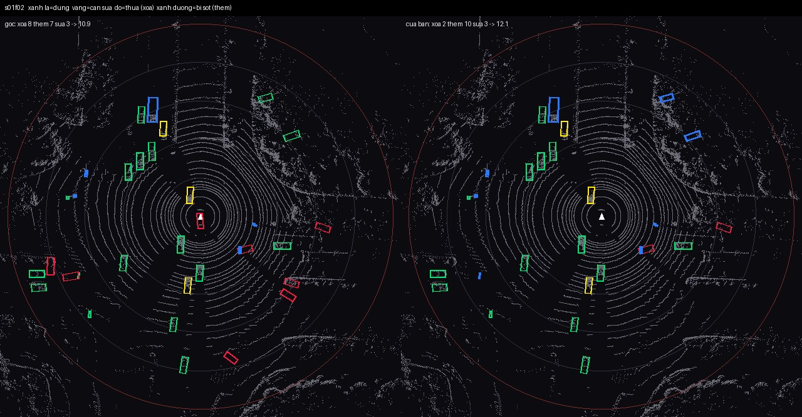

# Báo cáo Day 14 — Nguyễn Thành Đạt — 2A202603258

> Sao chép file này thành `report/individual/<MSSV>_<HoTen>.md` (không dấu), ví dụ `2A20260000_NguyenVanAn.md`.

- Mã học viên dùng với `--student`: `2A202603258`
- `seed_tag` trong `frames_A.txt`: `D14-CEA1144A4E81`

## 1. Dự đoán trước sweep (bước 5b)

Ghi **trước** khi chạy `scripts/pp_sweep.py`, rồi commit và push ngay (lịch sử commit là bằng chứng thời điểm viết). Không sửa phần này sau khi có kết quả.

- Tham số tôi nghĩ giảm công sửa nhiều nhất: score_thr
- Vì sao (nhìn ảnh BEV tập A: box thừa nhiều hay box sót nhiều?): box thừa nhiều

## 2. Tập A: sửa tay và tune

| Cấu hình           | Xóa | Thêm | Sửa | Chi phí |
| ------------------ | --: | ---: | --: | ------: |
| Gốc                |  27 |   10 |   3 |    19.6 |
| `best_config.json` |  22 |   10 |   3 |    18.1 |

- Tham số đã đổi trong `best_config.json`: `min_points: 0 -> 10` (`score_thr` giữ `0.1`). Lưới: `score_thr=0.1,0.2,0.3,0.4,0.5` × `min_points=0,5,10` (15 cấu hình × 3 frame). Chi phí giảm từ 19.6 xuống 18.1 (khoảng 7.7%), toàn bộ phần giảm đến từ 5 box thừa bị loại; số box phải thêm và phải sửa không đổi.
- Kết quả leave-one-out (dán các dòng `scripts/pp_sweep.py` in ra):

```
Top 10 (ghi đủ ở d14_2A202603258\sweep.csv):
    18.10  xóa  22 thêm  10 sửa   3  {'score_thr': '0.1', 'min_points': '10'}
    18.70  xóa  24 thêm  10 sửa   3  {'score_thr': '0.1', 'min_points': '5'}
    18.70  xóa  14 thêm  13 sửa   3  {'score_thr': '0.4', 'min_points': '10'}
    19.00  xóa  15 thêm  13 sửa   3  {'score_thr': '0.4', 'min_points': '5'}
    19.10  xóa  22 thêm  11 sửa   3  {'score_thr': '0.2', 'min_points': '10'}
    19.20  xóa  19 thêm  12 sửa   3  {'score_thr': '0.3', 'min_points': '10'}
    19.30  xóa  16 thêm  13 sửa   3  {'score_thr': '0.4', 'min_points': '0'}
    19.60  xóa  27 thêm  10 sửa   3  {'score_thr': '0.1', 'min_points': '0'}
    19.60  xóa   7 thêm  16 sửa   3  {'score_thr': '0.5', 'min_points': '10'}
    19.70  xóa  24 thêm  11 sửa   3  {'score_thr': '0.2', 'min_points': '5'}
Cấu hình tốt nhất → d14_2A202603258\best_config.json

Leave-one-out (chọn trên các frame còn lại, chấm trên frame bỏ ra):
  s01f02: cấu hình chọn {'score_thr': '0.5', 'min_points': '10'} → 11.8 (tốt nhất có thể 10.3)
  s03f22: cấu hình chọn {'score_thr': '0.1', 'min_points': '10'} → 6.9 (tốt nhất có thể 6.9)
  s04f18: cấu hình chọn {'score_thr': '0.1', 'min_points': '10'} → 0.9 (tốt nhất có thể 0.6)
```

- Cấu hình có ổn định trên từng frame không? Vì sao tôi vẫn chọn (hoặc không chọn) nó: `min_points=10` ổn định, vì cả 3 lần leave-one-out đều chọn nó và cột `min_points=10` luôn rẻ nhất ở mọi mức `score_thr`. `score_thr` thì không ổn định: khi bỏ `s01f02` ra, cấu hình được chọn nhảy sang `0.5`, và trên chính `s01f02` cấu hình chọn được kém mức tốt nhất 1.5. Tôi vẫn chọn `0.1/10` vì nó rẻ nhất tính trên cả 3 frame và chỉ đổi một tham số ổn định. Tăng `score_thr` lên cao thì bớt box phải xóa (0.3 điểm/box) nhưng lại tăng box phải thêm (1.0 điểm/box), nên không đáng.

## 3. Trước/sau (bước 8)



- `scripts/pp_compare.py` báo giảm (hoặc tăng) 2% công sửa trên tập A.
- Dự đoán ở mục 1 đúng hay sai? Giải thích bằng số box xóa/thêm/sửa: dự đoán mục 1 sai vì đã xóa 5 box, thêm 2 box, sửa 2 box.

## 4. Tập B

Số đo từ `scripts/pp_prelabel.py --frames d14_<ID>/frames_B.txt --config d14_<ID>/best_config.json --gt d14_<ID>/ref_B.json`:

| Xóa | Thêm | Sửa | Chi phí |
| --: | ---: | --: | ------: |
|  52 |   11 |   4 |    28.6 |

- Loại box tốn công sửa nhất ở tập B: box pedestrian

## 5. Giới hạn

- **Chỉ tune trên 3 frame và lưới nhỏ.** Chênh lệch giữa các cấu hình rất nhỏ (18.1 đến 20.3), và leave-one-out cho thấy `score_thr` tốt nhất thay đổi tùy frame (`s01f02` chọn `0.5`, hai frame còn lại chọn `0.1`). Với 3 frame, một frame đông xe hay đông người là đủ làm lệch kết quả. Lưới cũng chỉ thử 2 tham số; ngưỡng riêng từng lớp (`thr_ped`, `thr_car`) chưa được thử.
- **Chi phí là công thức, không phải thời gian sửa thật.** Công thức `0.3·xóa + 1.0·thêm + 0.5·sửa` coi thêm một box đắt hơn hơn 3 lần so với xóa một box. Trong sweep, tăng `score_thr` từ 0.1 lên 0.5 (với `min_points=10`) giảm số box phải xóa từ 22 xuống 7 nhưng tăng số box phải thêm từ 10 lên 16, nên tổng chi phí vẫn tăng (18.1 lên 19.6). Nếu trong thực tế xóa box tốn thời gian hơn mức 0.3 thì cấu hình tốt nhất có thể đã khác. Thời gian sửa thật trên CVAT còn phụ thuộc vào loại box (pedestrian nhỏ, khó căn) và khoảng cách, công thức không phản ánh những yếu tố này.
- **Model huấn luyện trên KITTI, không khớp hoàn toàn với dữ liệu VF.** Model không có lớp Truck/Bus, nên hai lớp này được đổi từ Car bằng luật kích thước và có thể sai nhãn. Model chỉ nhìn 90° phía trước nên phải xoay 4 lượt rồi gộp lại. Cường độ và độ cao mặt đất của LiDAR VF cũng khác KITTI. Pedestrian là loại tốn công sửa nhất ở tập B, khớp với việc PointPillars yếu với vật nhỏ, ít điểm.
